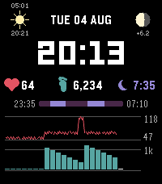

<!-- Generated by scripts/update_app_directory.py: do not edit by hand -->
[← All Pebble Developers](../developers.md)

# Piotr Migdał

*1 watchface · Last updated 2026-10-12 · [About these lists](../about-app-lists.md)*

Links: [Pebble App Store](https://apps.repebble.com/apps/dev/piotr-migda_e7e11c1645c1d7b38d9cb0c0) · [GitHub (stared)](https://github.com/stared)

<h2 class="app-name" id="app-0c064b7a21e841279cdc7bed"><a href="https://apps.repebble.com/0c064b7a21e841279cdc7bed">AstroLife</a> v1.0.3</h2>
<a class="app-source" href="https://github.com/stared/pebble-time-2-astrolife" title="Source code" data-search-exclude>View source</a>

Watchface

Released 2026-08-05 Updated 2026-08-06

Runs on: Time 2

Pebble Time 2 watchface with astronomy (moon phase countdown, sunrise/sunset) and health charts (pulse, steps, sleep).

