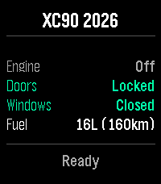
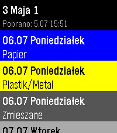

<!-- Generated by scripts/update_app_directory.py: do not edit by hand -->
[← All Pebble Developers](../developers.md)

# Piotr Serafin

*2 apps · Last updated 2026-10-12 · [About these lists](../about-app-lists.md)*

Links: [Pebble App Store](https://apps.repebble.com/apps/dev/piotr-serafin_a19d3e6ff0253a431a752641) · [GitHub (piotrserafin)](https://github.com/piotrserafin)

<button type="button" data-filter="all" aria-pressed="true">All 2</button><button type="button" data-filter="watchface" aria-pressed="false" disabled>Watchfaces 0</button><button type="button" data-filter="watchapp" aria-pressed="false">Apps 2</button>

<label class="dev-sort">Sort by <select><option value="updated">Recently updated</option><option value="released">Newest release</option><option value="title">A–Z</option></select></label>

<h2 class="app-name" id="app-c3e702834987434a8ec3d470"><a href="https://apps.repebble.com/c3e702834987434a8ec3d470">ReVolver</a> v1.1.0</h2>
<a class="app-source" href="https://github.com/piotrserafin/ReVolver" title="Source code" data-search-exclude>View source</a>

App

Released 2026-07-13 Updated 2026-09-04

Runs on: Round 2, Time 2, Pebble 2 Duo, Pebble 2, Time Round, Time, Classic

Remote control your Volvo car from your wrist. ReVolver — Remote Volvo controller. Also &quot;volver&quot; (Spanish): &quot;to return/come back&quot; to your car. Control your Volvo from your Pebble watch via the…

<h2 class="app-name" id="app-7116d162b29041aa94e40542"><a href="https://apps.repebble.com/7116d162b29041aa94e40542">WasteWatch</a> v1.0.0</h2>
<a class="app-source" href="https://github.com/piotrserafin/WasteWatch" title="Source code" data-search-exclude>View source</a>

App

Released 2026-07-05 Updated 2026-07-05

Runs on: Round 2, Time 2, Pebble 2 Duo, Pebble 2, Time Round, Time, Classic

Personal app to check my waste collection schedule without pulling out the phone. Shows upcoming dates with color-coded waste types (Bio, Paper, Plastics, Glass, Green, Mixed). Data from…

