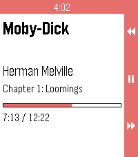
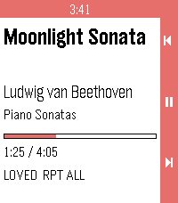

<!-- Generated by scripts/update_app_directory.py: do not edit by hand -->
[← All Pebble Developers](../developers.md)

# PiSCES

*2 apps · Last updated 2026-10-12 · [About these lists](../about-app-lists.md)*

Links: [Pebble App Store](https://apps.repebble.com/apps/dev/pisces_adc4868835dd4511698cd737) · [GitHub (P1R4N351)](https://github.com/P1R4N351)

<button type="button" data-filter="all" aria-pressed="true">All 2</button><button type="button" data-filter="watchface" aria-pressed="false" disabled>Watchfaces 0</button><button type="button" data-filter="watchapp" aria-pressed="false">Apps 2</button>

<label class="dev-sort">Sort by <select><option value="updated">Recently updated</option><option value="released">Newest release</option><option value="title">A–Z</option></select></label>

<h2 class="app-name" id="app-f1c75a4109aa488eab95f6da"><a href="https://apps.repebble.com/f1c75a4109aa488eab95f6da">Voice</a> v0.1.1</h2>
<a class="app-source" href="https://github.com/P1R4N351/voice-for-pebble" title="Source code" data-search-exclude>View source</a>

App

MPL-2.0 Released 2026-09-19 Updated 2026-09-19

Runs on: Time 2, Pebble 2 Duo

Voice for Pebble controls an Android audiobook player from the wrist. One watchapp drives two players: Voice, the open-source audiobook player, and Audible. It runs on Pebble 2 Duo and Pebble Time…

<h2 class="app-name" id="app-074924ee10c84f6bbde78ad3"><a href="https://apps.repebble.com/074924ee10c84f6bbde78ad3">Ultrasonic</a> v0.1.1</h2>
<a class="app-source" href="https://github.com/P1R4N351/ultrasonic-for-pebble" title="Source code" data-search-exclude>View source</a>

App

MPL-2.0 Released 2026-09-19 Updated 2026-09-19

Runs on: Time 2, Pebble 2 Duo

Ultrasonic for Pebble is a wrist-side controller for Ultrasonic, the open-source Subsonic/Navidrome client for Android. It runs on Pebble 2 Duo and Pebble Time 2, and it needs a small companion…

