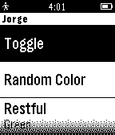

<!-- Generated by scripts/update_app_directory.py: do not edit by hand -->
[← All Pebble Developers](../developers.md)

# PixelSoup

*1 app · Last updated 2026-10-11 · [About these lists](../about-app-lists.md)*

Links: [Pebble App Store](https://apps.repebble.com/apps/dev/pixelsoup_5351d58a0fdc9b998f00006a) · [GitHub (jorgerdz)](https://github.com/jorgerdz)

<h2 class="app-name" id="app-552f7a8c06bedc3ef70000cd"><a href="https://apps.repebble.com/552f7a8c06bedc3ef70000cd">LIFxPebble</a> v0.6</h2>
<a class="app-source" href="https://github.com/jorgerdz/lifxpebble" title="Source code" data-search-exclude>View source</a>

App

Released 2015-04-16 Updated 2015-07-03

Runs on: Time 2, Pebble 2 Duo, Pebble 2, Time, Classic

A Pebble app for controlling your LIFX apps using the Cloud API. PayPal contributions are welcome at mail@jorgerdz.com, thanks! Reddit thread…

