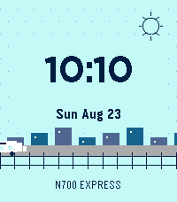

<!-- Generated by scripts/update_app_directory.py: do not edit by hand -->
[← All Pebble Developers](../developers.md)

# PizzaMan

*1 watchface · Last updated 2026-10-11 · [About these lists](../about-app-lists.md)*

Links: [Pebble App Store](https://apps.repebble.com/apps/dev/pizzaman_22682b6d06de33b457e5ec34)

<h2 class="app-name" id="app-8b4cba2c5cfe4c9ea4a38258"><a href="https://apps.repebble.com/8b4cba2c5cfe4c9ea4a38258">Minute Train</a> v1.0.0</h2>
<a class="app-source" href="https://ndiesslin.com" title="Source code" data-search-exclude>View source</a>

Watchface

Released 2026-08-23 Updated 2026-08-23

Runs on: Time 2, Pebble 2 Duo, Pebble 2, Time, Classic

Minute Train is a playful, glanceable digital Pebble watchface. A different train travels through the scene as the day moves from city commute to mountain railway, country freight, and a moonlit…

