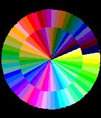
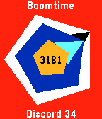

<!-- Generated by scripts/update_app_directory.py: do not edit by hand -->
[← All Pebble Developers](../developers.md)

# plan44.ch

*4 watchfaces · Last updated 2026-10-11 · [About these lists](../about-app-lists.md)*

Links: [Pebble App Store](https://apps.repebble.com/apps/dev/plan44-ch_52b2a87b8c0815bb5e0000d5) · [GitHub (plan44)](https://github.com/plan44) · [Website (mixwerk.ch)](http://www.mixwerk.ch/ziit_app.php)

<button type="button" data-filter="all" aria-pressed="true">All 4</button><button type="button" data-filter="watchface" aria-pressed="false">Watchfaces 4</button><button type="button" data-filter="watchapp" aria-pressed="false" disabled>Apps 0</button>

<label class="dev-sort">Sort by <select><option value="updated">Recently updated</option><option value="released">Newest release</option><option value="title">A–Z</option></select></label>

<h2 class="app-name" id="app-52b2a9c28c081503ed0000d6"><a href="https://apps.repebble.com/52b2a9c28c081503ed0000d6">Ziit</a> v2.2</h2>
<a class="app-source" href="https://github.com/plan44/ziit_pebble" title="Source code" data-search-exclude>View source</a>

Watchface

Released 2013-12-19 Updated 2015-10-24

Runs on: Round 2, Time 2, Pebble 2 Duo, Pebble 2, Time Round, Time, Classic

Swiss German text clock

<h2 class="app-name" id="app-5587ded03ae5e5b0de0000b6"><a href="https://apps.repebble.com/5587ded03ae5e5b0de0000b6">palette</a> v1.2</h2>
<a class="app-source" href="https://github.com/plan44/palette_pebble" title="Source code" data-search-exclude>View source</a>

Watchface

Released 2015-06-22 Updated 2015-10-24

Runs on: Round 2, Time 2, Time Round, Time

To celebrate the 64 colors of the new Pebble Time display, here&#x27;s a simple colorful watchface using 60 of them (excluding black, white and gray). Hint for reading the time: sharpest contrast…

<h2 class="app-name" id="app-5530e1e17add4311280000c3"><a href="https://apps.repebble.com/5530e1e17add4311280000c3">disclock - Discordian Clock</a> v1.2</h2>
<a class="app-source" href="https://github.com/plan44/disclock_pebble" title="Source code" data-search-exclude>View source</a>

Watchface

Released 2015-04-17 Updated 2015-10-24

Runs on: Round 2, Time 2, Pebble 2 Duo, Pebble 2, Time Round, Time, Classic

Pentagonal clock with discordian calendar display, including the 11 official holydays + Towel Day

<h2 class="app-name" id="app-52b2ab79b70e1c6a5a0000e7"><a href="https://apps.repebble.com/52b2ab79b70e1c6a5a0000e7">Timedot</a> v2.0.0</h2>
<a class="app-source" href="https://github.com/plan44/timedot_pebble" title="Source code" data-search-exclude>View source</a>

Watchface

Released 2013-12-19 Updated 2014-01-18

Runs on: Time 2, Pebble 2 Duo, Pebble 2, Time, Classic

This watchface shows time and date (as too many standard watchfaces don&#x27;t show the date), and reuses the wandering seconds dot from the my &quot;Ziit&quot; watchface

