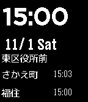

<!-- Generated by scripts/update_app_directory.py: do not edit by hand -->
[← All Pebble Developers](../developers.md)

# planset

*1 app · Last updated 2026-10-11 · [About these lists](../about-app-lists.md)*

Links: [Pebble App Store](https://apps.repebble.com/apps/dev/planset_530063a16061bd63ba000463) · [GitHub (planset)](https://github.com/planset) · [Website (dkpyn.com)](http://dkpyn.com)

<h2 class="app-name" id="app-5454937be77c146539000051"><a href="https://apps.repebble.com/5454937be77c146539000051">Saposub</a> v0.1</h2>
<a class="app-source" href="https://github.com/planset/pebble_sapporo_subway" title="Source code" data-search-exclude>View source</a>

App

Released 2014-11-01 Updated 2014-11-01

Runs on: Time 2, Pebble 2 Duo, Pebble 2, Time, Classic

札幌の地下鉄の時刻を表示します。 一番近くの駅の次の出発時刻を表示します。 今のところ東豊線のみです。 This watchapp shows the subway of time of Sapporo. It displays the next departure time of the nearest station. **Currently only Sapporo subway…

