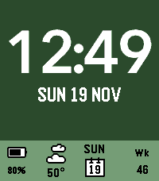

<!-- Generated by scripts/update_app_directory.py: do not edit by hand -->
[← All Pebble Developers](../developers.md)

# plarus

*1 watchface · Last updated 2026-10-11 · [About these lists](../about-app-lists.md)*

Links: [Rebble App Store](https://apps.rebble.io/en_US/developer/57c31d1d5e3c3de160000338/1) · [GitHub (plarus)](https://github.com/plarus)

<h2 class="app-name" id="app-5a48b54f0dfc32823d0041d5"><a href="https://apps.rebble.io/en_US/application/5a48b54f0dfc32823d0041d5">TimeStyle BB</a> v1.2</h2>
<a class="app-source" href="https://github.com/plarus/TimeStyleBBPebble" title="Source code" data-search-exclude>View source</a>

Watchface

Released 2017-12-31 Updated 2021-02-02 Rebble App Store

Runs on: Round 2, Time 2, Pebble 2 Duo, Pebble 2, Time Round, Time, Classic

Inspired by the visual language of the Timeline found on the Pebble Time, TimeStyle BB is designed as the “present” to complement the Timeline’s “past” and “future”. Various display options: Up to…

