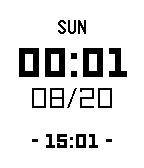

<!-- Generated by scripts/update_app_directory.py: do not edit by hand -->
[← All Pebble Developers](../developers.md)

# Po Cheng

*1 watchface · Last updated 2026-10-11 · [About these lists](../about-app-lists.md)*

Links: [Rebble App Store](https://apps.rebble.io/en_US/developer/567466b9a81715a6ad000057/1) · [GitHub (chengpo)](https://github.com/chengpo)

<h2 class="app-name" id="app-599935000dfc323e1100108c"><a href="https://apps.rebble.io/en_US/application/599935000dfc323e1100108c">Dual Time</a> v1.1</h2>
<a class="app-source" href="https://github.com/chengpo/dual-time" title="Source code" data-search-exclude>View source</a>

Watchface

Released 2017-08-20 Updated 2017-09-05 Rebble App Store

Runs on: Round 2, Time 2, Pebble 2 Duo, Pebble 2, Time Round, Time, Classic

A simple watchface which shows both local time and Chinese time on screen.

