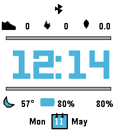

<!-- Generated by scripts/update_app_directory.py: do not edit by hand -->
[← All Pebble Developers](../developers.md)

# Pocket Gearwright

*1 watchface · Last updated 2026-10-12 · [About these lists](../about-app-lists.md)*

Links: [Pebble App Store](https://apps.repebble.com/apps/dev/pocket-gearwright_d28a6585342f0da8228ca76f) · [GitHub (superm1)](https://github.com/superm1)

<h2 class="app-name" id="app-9866ad086aed4791ae4a5cf4"><a href="https://apps.repebble.com/9866ad086aed4791ae4a5cf4">Rails</a> v0.0.5</h2>
<a class="app-source" href="https://github.com/superm1/rails-pebble" title="Source code" data-search-exclude>View source</a>

Watchface

Released 2026-05-11 Updated 2026-06-13

Runs on: Time 2

A watch face with rails to show your progress in daily goals (steps, calories, distance). The display is very rich and can show up to 6 data fields. All fields are configurable and can be swapped…

