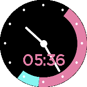

<!-- Generated by scripts/update_app_directory.py: do not edit by hand -->
[← All Pebble Developers](../developers.md)

# Pomodoro

*1 app · Last updated 2026-10-11 · [About these lists](../about-app-lists.md)*

Links: [Pebble App Store](https://apps.repebble.com/apps/dev/pomodoro_5583fc910a225d2a3d000020) · [GitHub (jojonki)](https://github.com/jojonki) · [Website (twitter.com)](https://twitter.com/jojonki)

<h2 class="app-name" id="app-56c5c3d61818a105fc000008"><a href="https://apps.repebble.com/56c5c3d61818a105fc000008">Pomodoro</a> v1.0</h2>
<a class="app-source" href="https://github.com/jojonki/pomodoro" title="Source code" data-search-exclude>View source</a>

App

Released 2016-02-18 Updated 2016-02-18

Runs on: Round 2, Time Round

25 minutes concentration and 5 minutes rest. Enjoy!

