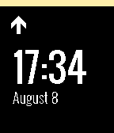

<!-- Generated by scripts/update_app_directory.py: do not edit by hand -->
[← All Pebble Developers](../developers.md)

# Poren Chiang

*1 watchface · Last updated 2026-10-12 · [About these lists](../about-app-lists.md)*

Links: [Pebble App Store](https://apps.repebble.com/apps/dev/poren-chiang_5589492eb0fe0583b00000ba) · [GitHub (rschiang)](https://github.com/rschiang)

<h2 class="app-name" id="app-55c5e92f3948b666a2000089"><a href="https://apps.repebble.com/55c5e92f3948b666a2000089">Metro</a> v1.1</h2>
<a class="app-source" href="https://github.com/rschiang/pebble-metro" title="Source code" data-search-exclude>View source</a>

Watchface

Released 2015-08-08 Updated 2015-08-09

Runs on: Time 2, Pebble 2 Duo, Pebble 2, Time, Classic

Metro is a Taipei Metro-inspired watchface for Pebble. It&#x27;s clean, elegant, and free as in freedom -- just like what you would expect on subway system wayfinding signs; and would rotate its color…

