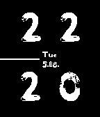

<!-- Generated by scripts/update_app_directory.py: do not edit by hand -->
[← All Pebble Developers](../developers.md)

# Pottkopp

*1 watchface · Last updated 2026-10-12 · [About these lists](../about-app-lists.md)*

Links: [Pebble App Store](https://apps.repebble.com/apps/dev/pottkopp_53dbbaf1943bdc90a00000e4) · [GitHub (pottkopp)](https://github.com/pottkopp)

<h2 class="app-name" id="app-53e13fb83c91651fb900005c"><a href="https://apps.repebble.com/53e13fb83c91651fb900005c">Project One</a> v1.10</h2>
<a class="app-source" href="https://github.com/pottkopp/ProjectONEWatchface" title="Source code" data-search-exclude>View source</a>

Watchface

Released 2014-08-05 Updated 2016-01-26

Runs on: Time 2, Pebble 2 Duo, Pebble 2, Time, Classic

My first watchface! Have fun with it! It shows: - hours - minutes - date: DD.MM. - name of the day (shortcut) - battery bar - inverted screen when charging ___ Fonts: Black Metal Sans by Jonathan…

