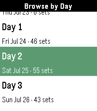

<!-- Generated by scripts/update_app_directory.py: do not edit by hand -->
[← All Pebble Developers](../developers.md)

# Pottkopp

*1 app · Last updated 2026-10-11 · [About these lists](../about-app-lists.md)*

Links: [Pebble App Store](https://apps.repebble.com/apps/dev/pottkopp_82c5b97291d272e0b4e1aa46) · [GitHub (eric-lindholm)](https://github.com/eric-lindholm)

<h2 class="app-name" id="app-e803cc1eebcc4ffc9df7a86e"><a href="https://apps.repebble.com/e803cc1eebcc4ffc9df7a86e">Liquicity 2026</a> v1.0.1</h2>
<a class="app-source" href="https://github.com/eric-lindholm/bonnaroo-26/" title="Source code" data-search-exclude>View source</a>

App

Released 2026-07-23 Updated 2026-07-23

Runs on: Time 2, Pebble 2 Duo, Pebble 2

Unofficial Timetable watchapp for Liquicity 2026. Browse shows, plan your festival, and get reminders when a show you don&#x27;t want to miss is coming up. Browse shows by day or stage, click into a…

