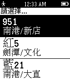

<!-- Generated by scripts/update_app_directory.py: do not edit by hand -->
[← All Pebble Developers](../developers.md)

# Pou

*1 app · Last updated 2026-10-12 · [About these lists](../about-app-lists.md)*

Links: [Pebble App Store](https://apps.repebble.com/apps/dev/pou_550598a7b2a34db5d5000012)

<h2 class="app-name" id="app-5516e3b35ca7494b610000d4"><a href="https://apps.repebble.com/5516e3b35ca7494b610000d4">Taiwan Bus Info</a> v1.01</h2>
<a class="app-source" href="http://www.dotblogs.com.tw/pou" title="Source code" data-search-exclude>View source</a>

App

Released 2015-03-28 Updated 2015-03-31

Runs on: Time 2, Pebble 2 Duo, Pebble 2, Time, Classic

快速查詢關注的公車與到達指定站點的時間。 需搭配手機至 App Settings 加入關注的公車。

