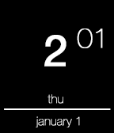
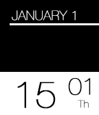

<!-- Generated by scripts/update_app_directory.py: do not edit by hand -->
[← All Pebble Developers](../developers.md)

# Pranav Vishnu

*2 watchfaces · Last updated 2026-10-12 · [About these lists](../about-app-lists.md)*

Links: [Pebble App Store](https://apps.repebble.com/apps/dev/pranav-vishnu_52dda9125d0e578ad3000013) · [GitHub (pvrnav)](https://github.com/pvrnav) · [GitHub (pranavvishnu)](https://github.com/pranavvishnu)

<button type="button" data-filter="all" aria-pressed="true">All 2</button><button type="button" data-filter="watchface" aria-pressed="false">Watchfaces 2</button><button type="button" data-filter="watchapp" aria-pressed="false" disabled>Apps 0</button>

<label class="dev-sort">Sort by <select><option value="updated">Recently updated</option><option value="released">Newest release</option><option value="title">A–Z</option></select></label>

<h2 class="app-name" id="app-52f15c408d40be941000034b"><a href="https://apps.repebble.com/52f15c408d40be941000034b">Clear Watch</a> v1.1</h2>
<a class="app-source" href="https://github.com/pvrnav/clear-watch" title="Source code" data-search-exclude>View source</a>

Watchface

Released 2014-02-04 Updated 2014-02-08

Runs on: Time 2, Pebble 2 Duo, Pebble 2, Time, Classic

A simple watch face using Helvetica Neue that shows the time, day and date. Supports both 12 &amp; 24 hour modes. Made to go easy on your battery.

<h2 class="app-name" id="app-52e17e505b1d9ec9e60000aa"><a href="https://apps.repebble.com/52e17e505b1d9ec9e60000aa">Clean Watch</a> v1.0</h2>
<a class="app-source" href="https://github.com/pranavvishnu/clean-watch" title="Source code" data-search-exclude>View source</a>

Watchface

Released 2014-01-23 Updated 2014-02-08

Runs on: Time 2, Pebble 2 Duo, Pebble 2, Time, Classic

A simple, clean watch face using Helvetica Neue. Displays Time, Date and Day. Supports both 24 and 12-hour Modes. Made to go easy on your battery, as time only updates once a minute.

