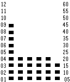

<!-- Generated by scripts/update_app_directory.py: do not edit by hand -->
[← All Pebble Developers](../developers.md)

# Prashant Kamdar

*1 watchface · Last updated 2026-10-12 · [About these lists](../about-app-lists.md)*

Links: [Pebble App Store](https://apps.repebble.com/apps/dev/prashant-kamdar_57383b318498c1b2c5000011) · [GitHub (prashantkamdar)](https://github.com/prashantkamdar)

<h2 class="app-name" id="app-5741d9dbd4d80647f0000011"><a href="https://apps.repebble.com/5741d9dbd4d80647f0000011">TimeSqaures</a> v1.0</h2>
<a class="app-source" href="https://github.com/prashantkamdar/TimeSquares" title="Source code" data-search-exclude>View source</a>

Watchface

Released 2016-05-22 Updated 2016-05-22

Runs on: Time 2, Pebble 2 Duo, Pebble 2, Time, Classic

Hours 1-12 are displayed in the left most column, from the bottom to the top; each square represents an hour. Minutes are from the bottom right (second column onwards); each square represents a…

