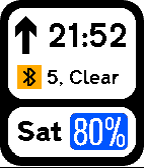

<!-- Generated by scripts/update_app_directory.py: do not edit by hand -->
[← All Pebble Developers](../developers.md)

# prayerie

*2 watchfaces · Last updated 2026-10-12 · [About these lists](../about-app-lists.md)*

Links: [Rebble App Store](https://apps.rebble.io/en_US/developer/6035842a1342ae0057ecf1aa/1) · [GitHub (mistyhands)](https://github.com/mistyhands)

<button type="button" data-filter="all" aria-pressed="true">All 2</button><button type="button" data-filter="watchface" aria-pressed="false">Watchfaces 2</button><button type="button" data-filter="watchapp" aria-pressed="false" disabled>Apps 0</button>

<label class="dev-sort">Sort by <select><option value="updated">Recently updated</option><option value="released">Newest release</option><option value="title">A–Z</option></select></label>

<h2 class="app-name" id="app-603fc6611342ae01e302d010"><a href="https://apps.rebble.io/en_US/application/603fc6611342ae01e302d010">NERV</a> v1.5</h2>
<a class="app-source" href="https://github.com/mistyhands/pebble-nerv/" title="Source code" data-search-exclude>View source</a>

Watchface

Released 2021-03-03 Updated 2021-06-27 Rebble App Store

Runs on: Round 2, Time 2, Pebble 2 Duo, Pebble 2, Time Round, Time, Classic

A Neon Genesis Evangelion themed watchface. Battery is in the top-left and shown in four bars. The weather status is shown via a red indicator and categorised as follows - CLEAR (clear sky) CLOUD…

<h2 class="app-name" id="app-6035842a1342ae0057ecf1ab"><a href="https://apps.rebble.io/en_US/application/6035842a1342ae0057ecf1ab">Transport</a> v1.0-rbl</h2>
<a class="app-source" href="https://github.com/mistyhands/pebble-transport" title="Source code" data-search-exclude>View source</a>

Watchface

Released 2021-02-23 Updated 2021-03-01 Rebble App Store

Runs on: Time 2, Time

Watchface stylized after UK road signs.

