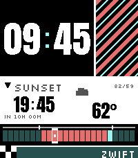

<!-- Generated by scripts/update_app_directory.py: do not edit by hand -->
[← All Pebble Developers](../developers.md)

# Precision Complication

*1 watchface · Last updated 2026-10-12 · [About these lists](../about-app-lists.md)*

Links: [Pebble App Store](https://apps.repebble.com/apps/dev/precision-complication_8df83e56cd3e1befd02a234e) · [GitHub (tylerjw)](https://github.com/tylerjw)

<h2 class="app-name" id="app-7e4d835448be4ebdb749565a"><a href="https://apps.repebble.com/7e4d835448be4ebdb749565a">Cadence Pavé</a> v1.0.1</h2>
<a class="app-source" href="https://github.com/tylerjw/cadence-pave" title="Source code" data-search-exclude>View source</a>

Watchface

Released 2026-08-26 Updated 2026-08-26

Runs on: Time 2

The day as 24 blocks, and the last hour of light in red. Most watchfaces tell you the time. This one also tells you how much daylight is left, at a glance, without reading a number. The strip…

