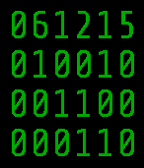
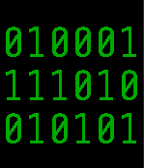

<!-- Generated by scripts/update_app_directory.py: do not edit by hand -->
[← All Pebble Developers](../developers.md)

# Precision Craftsman

*2 watchfaces · Last updated 2026-10-11 · [About these lists](../about-app-lists.md)*

Links: [Pebble App Store](https://apps.repebble.com/apps/dev/precision-craftsman_542860e869f2895d7d000092) · [GitHub (RobOfTheSkyPeople)](https://github.com/RobOfTheSkyPeople)

<button type="button" data-filter="all" aria-pressed="true">All 2</button><button type="button" data-filter="watchface" aria-pressed="false">Watchfaces 2</button><button type="button" data-filter="watchapp" aria-pressed="false" disabled>Apps 0</button>

<label class="dev-sort">Sort by <select><option value="updated">Recently updated</option><option value="released">Newest release</option><option value="title">A–Z</option></select></label>

<h2 class="app-name" id="app-557b67179362832c2e000088"><a href="https://apps.repebble.com/557b67179362832c2e000088">6-Bit Homebrew Binary Watchface with Date</a> v1.0</h2>
<a class="app-source" href="https://github.com/RobOfTheSkyPeople/PblHomebrew6bitBinaryWithDate" title="Source code" data-search-exclude>View source</a>

Watchface

No licence Released 2015-06-12 Updated 2015-06-12

Runs on: Time 2, Time

This is my first working modification of MyNameIsKir&#x27;s Binary Watch watchface for the Pebble Smart Watch (https://github.com/MyNameIsKir/Pebble-Binary-Watch-C). Most of the code is hers; I just…

<h2 class="app-name" id="app-5577640011de61b39f00006b"><a href="https://apps.repebble.com/5577640011de61b39f00006b">6-bit Homebrew Binary Watchface</a> v1.0</h2>
<a class="app-source" href="https://github.com/RobOfTheSkyPeople/PblHomebrew6bitBinary" title="Source code" data-search-exclude>View source</a>

Watchface

No licence Released 2015-06-09 Updated 2015-06-12

Runs on: Time 2, Time

6-bit binary watchface in homebrew colors derived from MyNameIsKir&#x27;s Binary Watch face.

