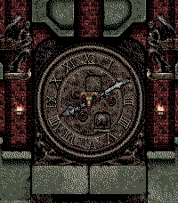

<!-- Generated by scripts/update_app_directory.py: do not edit by hand -->
[← All Pebble Developers](../developers.md)

# PrefixCombo

*1 watchface · Last updated 2026-11-02 · [About these lists](../about-app-lists.md)*

Links: [Pebble App Store](https://apps.repebble.com/apps/dev/prefixcombo_ac6b6eb93b626ef743e83fd6) · [GitHub (prefixcombo)](https://github.com/prefixcombo)

<h2 class="app-name" id="app-35dd38e09ea647c181dd1b35"><a href="https://apps.repebble.com/35dd38e09ea647c181dd1b35">Clock Room</a> v1.0</h2>
<a class="app-source" href="https://github.com/prefixcombo/Clock-Room" title="Source code" data-search-exclude>View source</a>

Watchface

No licence Released 2026-11-02 Updated 2026-11-02

Runs on: Round 2, Time 2, Time Round, Time

An analog watchface based on the clock room from Castlevania: Symphony of the Night.

