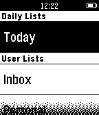

<!-- Generated by scripts/update_app_directory.py: do not edit by hand -->
[← All Pebble Developers](../developers.md)

# Prient Technologies

*1 app · Last updated 2026-10-11 · [About these lists](../about-app-lists.md)*

Links: [Pebble App Store](https://apps.repebble.com/apps/dev/prient-technologies_52fa60cea9b8fa62e70002c5) · [GitHub (Rocketeer007)](https://github.com/Rocketeer007)

<h2 class="app-name" id="app-55085c157d3b94cb14000029"><a href="https://apps.repebble.com/55085c157d3b94cb14000029">Task Checker</a> v1.1</h2>
<a class="app-source" href="https://github.com/Rocketeer007/TaskChecker" title="Source code" data-search-exclude>View source</a>

App

No licence Released 2015-03-17 Updated 2016-10-21

Runs on: Time 2, Pebble 2 Duo, Pebble 2, Time, Classic

Quickly view, complete or postpone your Remember the Milk tasks from your Pebble. Based on Pebble.JS, so requires an online connection to your phone. This product uses the Remember The Milk API…

