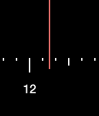

<!-- Generated by scripts/update_app_directory.py: do not edit by hand -->
[← All Pebble Developers](../developers.md)

# Priyesh Patel

*1 watchface · Last updated 2026-10-12 · [About these lists](../about-app-lists.md)*

Links: [Pebble App Store](https://apps.repebble.com/apps/dev/priyesh-patel_557effc2e512e387fd000038) · [GitHub (ItsPriyesh)](https://github.com/ItsPriyesh)

<h2 class="app-name" id="app-56512a8ba69d971f08000038"><a href="https://apps.repebble.com/56512a8ba69d971f08000038">Dial</a> v1.1</h2>
<a class="app-source" href="https://github.com/ItsPriyesh/Dial" title="Source code" data-search-exclude>View source</a>

Watchface

No licence Released 2015-11-22 Updated 2015-12-05

Runs on: Round 2, Time 2, Time Round, Time

A watchface. Shake to show the date.

