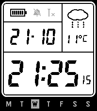

<!-- Generated by scripts/update_app_directory.py: do not edit by hand -->
[← All Pebble Developers](../developers.md)

# Pryning

*1 watchface · Last updated 2026-11-02 · [About these lists](../about-app-lists.md)*

Links: [Pebble App Store](https://apps.repebble.com/apps/dev/pryning_95252b3859ef6345dab6010c) · [GitHub (Pryning)](https://github.com/Pryning)

<h2 class="app-name" id="app-63cc90f0dfba458ab23b4af5"><a href="https://apps.repebble.com/63cc90f0dfba458ab23b4af5">Peb-cio</a> v1.0.1</h2>
<a class="app-source" href="https://github.com/Pryning/pebcio" title="Source code" data-search-exclude>View source</a>

Watchface

GPL-3.0 Released 2026-10-21 Updated 2026-11-01

Runs on: Time 2

Pebble + Casio = Peb-cio ¯\_(ツ)_/¯ Casio-style LCD watchface for Pebble Time 2, inspired by CORE91 by tc5206 and the Casio W-800H. Big 7-segment time with seconds after any interaction (wrist…

