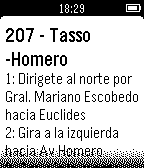

<!-- Generated by scripts/update_app_directory.py: do not edit by hand -->
[← All Pebble Developers](../developers.md)

# Psyrax

*1 app · Last updated 2026-10-12 · [About these lists](../about-app-lists.md)*

Links: [Pebble App Store](https://apps.repebble.com/apps/dev/psyrax_54500432ba4430c8b200008a) · [GitHub (psyrax)](https://github.com/psyrax) · [Website (psyrax.github.io)](http://psyrax.github.io/terminalWatch/)

<h2 class="app-name" id="app-5488eb4c7d4e8e3f70000037"><a href="https://apps.repebble.com/5488eb4c7d4e8e3f70000037">Ecobici DX</a> v1.2</h2>
<a class="app-source" href="https://github.com/psyrax/terminalWatch" title="Source code" data-search-exclude>View source</a>

App

Released 2014-12-11 Updated 2016-06-07

Runs on: Time 2, Pebble 2 Duo, Pebble 2, Time, Classic

Get ecobici locations and info of stations nearby. Base API data from http://api.citybik.es/v2/ and https://ecobici.me/#/ Logo art by https://twitter.com/vampipe

