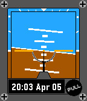

<!-- Generated by scripts/update_app_directory.py: do not edit by hand -->
[← All Pebble Developers](../developers.md)

# PyroPenguin

*2 watchfaces · Last updated 2026-10-11 · [About these lists](../about-app-lists.md)*

Links: [Pebble App Store](https://apps.repebble.com/apps/dev/pyropenguin_52a93a1e79c18f597c000019) · [GitHub (pyropenguin)](https://github.com/pyropenguin)

<button type="button" data-filter="all" aria-pressed="true">All 2</button><button type="button" data-filter="watchface" aria-pressed="false">Watchfaces 2</button><button type="button" data-filter="watchapp" aria-pressed="false" disabled>Apps 0</button>

<label class="dev-sort">Sort by <select><option value="updated">Recently updated</option><option value="released">Newest release</option><option value="title">A–Z</option></select></label>

<h2 class="app-name" id="app-55062961afe7fb3d80000094"><a href="https://apps.repebble.com/55062961afe7fb3d80000094">Pi Time</a> v1.2</h2>
<a class="app-source" href="https://github.com/pyropenguin/PiTime.git" title="Source code" data-search-exclude>View source</a>

Watchface

Released 2015-03-16 Updated 2016-03-13

Runs on: Round 2, Time 2, Pebble 2 Duo, Pebble 2, Time Round, Time, Classic

Simple watchface that counts down to the next Pi time, on the next Pi day. Pi Time is on March 14 at 1:59:26 PM.

<h2 class="app-name" id="app-554ab78093cc44c1d10000dd"><a href="https://apps.repebble.com/554ab78093cc44c1d10000dd">Attitude Indicator</a> v1.0</h2>
<a class="app-source" href="http://www.github.com/pyropenguin/AttitudeIndicator" title="Source code" data-search-exclude>View source</a>

Watchface

No licence Released 2015-05-07 Updated 2015-05-07

Runs on: Time 2, Time

A simple attitude indicator for Pebble. Completes a full roll each minute.

