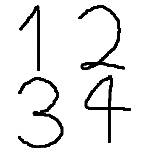

<!-- Generated by scripts/update_app_directory.py: do not edit by hand -->
[← All Pebble Developers](../developers.md)

# quarter

*1 watchface · Last updated 2026-10-12 · [About these lists](../about-app-lists.md)*

Links: [Pebble App Store](https://apps.repebble.com/apps/dev/quarter_52f325bc1f27f5136200040b) · [GitHub (quartersdg)](https://github.com/quartersdg)

<h2 class="app-name" id="app-5448714d00cbca32f1000046"><a href="https://apps.repebble.com/5448714d00cbca32f1000046">bezier</a> v1.1</h2>
<a class="app-source" href="https://github.com/quartersdg/bezier" title="Source code" data-search-exclude>View source</a>

Watchface

Released 2014-10-23 Updated 2014-12-24

Runs on: Time 2, Pebble 2 Duo, Pebble 2, Time, Classic

Draws digits using bezier curves and morphs between digits as time passes.

