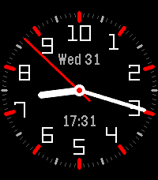

<!-- Generated by scripts/update_app_directory.py: do not edit by hand -->
[← All Pebble Developers](../developers.md)

# Quartz Calibrator

*1 watchface · Last updated 2026-11-23 · [About these lists](../about-app-lists.md)*

Links: [Pebble App Store](https://apps.repebble.com/apps/dev/quartz-calibrator_e61b6517cfdf870a2e2c60cf) · [GitHub (eklimbie)](https://github.com/eklimbie)

<h2 class="app-name" id="app-5ac12856fb884322b0b0600e"><a href="https://apps.repebble.com/5ac12856fb884322b0b0600e">DeciTime</a> v1.8.0</h2>
<a class="app-source" href="https://github.com/eklimbie/pebble-decitime" title="Source code" data-search-exclude>View source</a>

Watchface

AGPL-3.0 Released 2026-11-21 Updated 2026-11-21

Runs on: Round 2, Time 2, Pebble 2 Duo, Pebble 2, Time Round, Time, Classic

DeciTime tells the time the way the French Revolution tried to: 10 hours a day, 100 minutes an hour, 100 seconds a minute. Midnight is 0:00, noon is 5:00. Choose a ten-hour analog dial (round, or…

