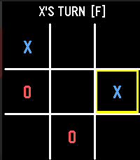

<!-- Generated by scripts/update_app_directory.py: do not edit by hand -->
[← All Pebble Developers](../developers.md)

# Quartz Clocksmith

*1 app · Last updated 2026-10-12 · [About these lists](../about-app-lists.md)*

Links: [Pebble App Store](https://apps.repebble.com/apps/dev/quartz-clocksmith_408e0031a56070b91136c7c6) · [GitHub (lynxmonkey)](https://github.com/lynxmonkey)

<h2 class="app-name" id="app-b4eb7f620ba64bc6b7c56e02"><a href="https://apps.repebble.com/b4eb7f620ba64bc6b7c56e02">Toroidal Tic-Tac-Toe</a> v0.9</h2>
<a class="app-source" href="https://github.com/lynxmonkey/Tic-Tac-Tor_Pebble" title="Source code" data-search-exclude>View source</a>

App

Released 2026-10-06 Updated 2026-10-06

Runs on: Round 2, Time 2, Time Round

tic-tac-toe game, but on a 3D torus. A very simple game where every box is a center and the edges all wrap around.

