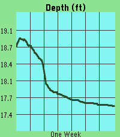

<!-- Generated by scripts/update_app_directory.py: do not edit by hand -->
[← All Pebble Developers](../developers.md)

# Quentin Monagle

*1 app · Last updated 2026-10-11 · [About these lists](../about-app-lists.md)*

Links: [Pebble App Store](https://apps.repebble.com/apps/dev/quentin-monagle_23d70dbde1f8d619a24b316c) · [GitHub (qmonagle)](https://github.com/qmonagle)

<h2 class="app-name" id="app-f0b97c77cced465aa69b5044"><a href="https://apps.repebble.com/f0b97c77cced465aa69b5044">River Depth</a> v0.6</h2>
<a class="app-source" href="https://github.com/qmonagle/RiverData" title="Source code" data-search-exclude>View source</a>

App

Released 2026-04-13 Updated 2026-04-24

Runs on: Time 2, Pebble 2 Duo, Pebble 2, Time, Classic

This app pulls depth data from river monitoring locations tracked by USGS. It then plots the last week of data, scaling automatically to your screen. The ID will default to a location near…

