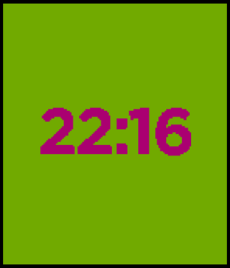
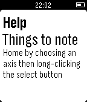
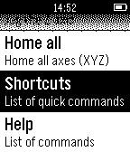

<!-- Generated by scripts/update_app_directory.py: do not edit by hand -->
[← All Pebble Developers](../developers.md)

# quillford

*1 watchface and 2 apps · Last updated 2026-10-12 · [About these lists](../about-app-lists.md)*

Links: [Pebble App Store](https://apps.repebble.com/apps/dev/quillford_54977fc0754bc13c3f00005e) · [GitHub (quillford)](https://github.com/quillford)

<button type="button" data-filter="all" aria-pressed="true">All 3</button><button type="button" data-filter="watchface" aria-pressed="false">Watchfaces 1</button><button type="button" data-filter="watchapp" aria-pressed="false">Apps 2</button>

<label class="dev-sort">Sort by <select><option value="updated">Recently updated</option><option value="released">Newest release</option><option value="title">A–Z</option></select></label>

<h2 class="app-name" id="app-5551874ce979af0c360000d7"><a href="https://apps.repebble.com/5551874ce979af0c360000d7">Simple Colors</a> v1.1</h2>
<a class="app-source" href="https://github.com/quillford/SimpleColor-Pebble" title="Source code" data-search-exclude>View source</a>

Watchface

Released 2015-05-12 Updated 2015-05-12

Runs on: Time 2, Time

This is a simple watchface that gets a random color for the time and background every minute.

<h2 class="app-name" id="app-553dbc0dbdf9b3ae8c000025"><a href="https://apps.repebble.com/553dbc0dbdf9b3ae8c000025">SmoothieControl</a> v1.0</h2>
<a class="app-source" href="https://github.com/quillford/SmoothieControl-Pebble" title="Source code" data-search-exclude>View source</a>

App

Released 2015-04-27 Updated 2015-04-27

Runs on: Time 2, Pebble 2 Duo, Pebble 2, Time, Classic

Control your Smoothieware powered device with your watch! You can do things such as homing axes, jogging, and fan control.

<h2 class="app-name" id="app-553d8acde95db472f8000021"><a href="https://apps.repebble.com/553d8acde95db472f8000021">OctoControl - Control your 3D printer with your watch</a> v1.0</h2>
<a class="app-source" href="https://github.com/quillford/OctoControl-Pebble" title="Source code" data-search-exclude>View source</a>

App

Released 2015-04-27 Updated 2015-04-27

Runs on: Time 2, Pebble 2 Duo, Pebble 2, Time, Classic

OctoControl allows you to use your watch to control your 3D printer. You can do things such as jogging, homing, controlling fans, and turning the motors off. Note: This requires that you have…

