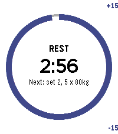

<!-- Generated by scripts/update_app_directory.py: do not edit by hand -->
[← All Pebble Developers](../developers.md)

# Quillsh

*1 app · Last updated 2026-10-26 · [About these lists](../about-app-lists.md)*

Links: [Rebble App Store](https://apps.rebble.io/en_US/developer/6956d4e1eea8e40008bcce62/1) · [GitHub (Terence-wilson)](https://github.com/Terence-wilson) · [Website (terence-wilson.github.io)](https://terence-wilson.github.io/mysite/)

<h2 class="app-name" id="app-6ad2a480f9d9480009aa94dd"><a href="https://apps.rebble.io/en_US/application/6ad2a480f9d9480009aa94dd">Pebblesaur</a> v1.0.0</h2>
<a class="app-source" href="https://github.com/Terence-wilson/Pebblesaur" title="Source code" data-search-exclude>View source</a>

App

No licence Released 2026-10-16 Updated 2026-10-16 Rebble App Store

Runs on: Round 2, Time 2, Pebble 2 Duo, Pebble 2, Time Round, Time

Run your Liftosaur workout from your wrist. Pebblesaur connects to Liftosaur&#x27;s REST API, so progressions, 1RMs and your next workout day update exactly as if you had used the Liftosaur app. - See…

