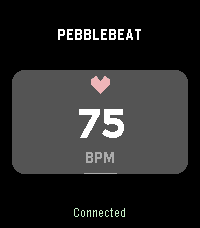

<!-- Generated by scripts/update_app_directory.py: do not edit by hand -->
[← All Pebble Developers](../developers.md)

# quinn50

*1 app · Last updated 2026-11-02 · [About these lists](../about-app-lists.md)*

Links: [Pebble App Store](https://apps.repebble.com/apps/dev/quinn50_5e29e054c5536759d4a5bf5d) · [GitHub (stearnsbq)](https://github.com/stearnsbq)

<h2 class="app-name" id="app-cdae49b4b5834598b586d30d"><a href="https://apps.repebble.com/cdae49b4b5834598b586d30d">PebbleBeat</a> v1.0.1</h2>
<a class="app-source" href="https://github.com/stearnsbq/cardibble" title="Source code" data-search-exclude>View source</a>

App

No licence Released 2026-10-24 Updated 2026-10-24

Runs on: Time 2

A simple pebble time 2 app to forward heart rate data over websocket in the json format: {bpm: int, latest_rr_ms: int, battery: int}

