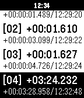
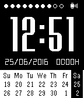

<!-- Generated by scripts/update_app_directory.py: do not edit by hand -->
[← All Pebble Developers](../developers.md)

# qwqert

*2 watchfaces and 2 apps · Last updated 2026-10-11 · [About these lists](../about-app-lists.md)*

Links: [Pebble App Store](https://apps.repebble.com/apps/dev/qwqert_563040ae4cb14285e0000029) · [GitHub (qwqert)](https://github.com/qwqert)

<button type="button" data-filter="all" aria-pressed="true">All 4</button><button type="button" data-filter="watchface" aria-pressed="false">Watchfaces 2</button><button type="button" data-filter="watchapp" aria-pressed="false">Apps 2</button>

<label class="dev-sort">Sort by <select><option value="updated">Recently updated</option><option value="released">Newest release</option><option value="title">A–Z</option></select></label>

<h2 class="app-name" id="app-576e5f436c2104f46f000010"><a href="https://apps.repebble.com/576e5f436c2104f46f000010">thins</a> v1.0</h2>
<a class="app-source" href="https://github.com/qwqert/Pebble_watchfaces.git" title="Source code" data-search-exclude>View source</a>

Watchface

Released 2016-06-25 Updated 2016-06-25

Runs on: Time 2, Pebble 2 Duo, Pebble 2, Time, Classic

A simple watchface based on thin.

<h2 class="app-name" id="app-576e0cf5ba2fe50eb0000018"><a href="https://apps.repebble.com/576e0cf5ba2fe50eb0000018">Lap counter</a> v1.0</h2>
<a class="app-source" href="https://github.com/qwqert/Pebble_apps" title="Source code" data-search-exclude>View source</a>

App

Released 2016-06-25 Updated 2016-06-25

Runs on: Time 2, Pebble 2 Duo, Pebble 2, Time, Classic

A simple lap counter for runner or swimmer.

<h2 class="app-name" id="app-56e4ccd2b7a6010bb800002c"><a href="https://apps.repebble.com/56e4ccd2b7a6010bb800002c">Calendar Face</a> v1.2</h2>
<a class="app-source" href="https://github.com/qwqert/Pebble_watchfaces.git" title="Source code" data-search-exclude>View source</a>

Watchface

Released 2016-03-13 Updated 2016-06-25

Runs on: Time 2, Pebble 2 Duo, Pebble 2, Time, Classic

- Show simple calendar - Show battery level (dots) - Show bluetooth connection status - Show how many days and hours since last charge

<h2 class="app-name" id="app-576e48e2ba2fe55fb2000029"><a href="https://apps.repebble.com/576e48e2ba2fe55fb2000029">Battery life</a> v1.0</h2>
<a class="app-source" href="https://github.com/qwqert/Pebble_apps" title="Source code" data-search-exclude>View source</a>

App

Released 2016-06-25 Updated 2016-06-25

Runs on: Time 2, Pebble 2 Duo, Pebble 2, Time, Classic

Trace how many days your battery has lasted.

