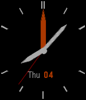

<!-- Generated by scripts/update_app_directory.py: do not edit by hand -->
[← All Pebble Developers](../developers.md)

# R McCoy

*1 watchface · Last updated 2026-10-11 · [About these lists](../about-app-lists.md)*

Links: [Pebble App Store](https://apps.repebble.com/apps/dev/r-mccoy_52f0f56b61b752a552002aa4) · [GitHub (rmccoy777)](https://github.com/rmccoy777)

<h2 class="app-name" id="app-5570e9d8ddc5cc1f95000053"><a href="https://apps.repebble.com/5570e9d8ddc5cc1f95000053">GMT Explorer</a> v1.0</h2>
<a class="app-source" href="https://github.com/rmccoy777/gmt_explorer" title="Source code" data-search-exclude>View source</a>

Watchface

Released 2015-06-05 Updated 2015-06-06

Runs on: Time 2, Time

Based off of simple analog. White hands for local time, orange is GMT or UTC(zulu). Future I will add the option to pick timezones.

