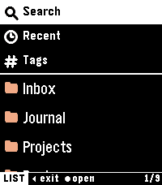

<!-- Generated by scripts/update_app_directory.py: do not edit by hand -->
[← All Pebble Developers](../developers.md)

# Rad1ally

*1 app · Last updated 2026-10-12 · [About these lists](../about-app-lists.md)*

Links: [Pebble App Store](https://apps.repebble.com/apps/dev/unknown_d03cd6b6993c081f27c2fc87) · [GitHub (Rad1ally)](https://github.com/Rad1ally)

<h2 class="app-name" id="app-e64f7bcd1ef249d092bfb44e"><a href="https://apps.repebble.com/e64f7bcd1ef249d092bfb44e">ZenNotes for Pebble</a> v0.1.0</h2>
<a class="app-source" href="https://github.com/Rad1ally/pebble-zennotes" title="Source code" data-search-exclude>View source</a>

App

MIT Released 2026-10-12 Updated 2026-10-12

Runs on: Time 2

Read your ZenNotes on your wrist. ZenNotes for Pebble connects to your self-hosted ZenNotes server (znserver) and shows your Markdown notes on Pebble Time 2. It is read-only, so your vault is…

