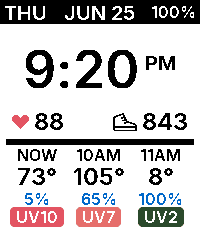

<!-- Generated by scripts/update_app_directory.py: do not edit by hand -->
[← All Pebble Developers](../developers.md)

# Radiant Sundial

*1 watchface · Last updated 2026-10-11 · [About these lists](../about-app-lists.md)*

Links: [Pebble App Store](https://apps.repebble.com/apps/dev/radiant-sundial_f357582fc5ad05ef48b1f6d2) · [GitHub (aidankierans)](https://github.com/aidankierans)

<h2 class="app-name" id="app-e6c6572df8cc48d5b8b042e8"><a href="https://apps.repebble.com/e6c6572df8cc48d5b8b042e8">Weather Soon</a> v1.1.0</h2>
<a class="app-source" href="https://github.com/aidankierans/WeatherSoon" title="Source code" data-search-exclude>View source</a>

Watchface

MIT Released 2026-06-26 Updated 2026-09-11

Runs on: Time 2

An easy display of current and hourly weather, including UV index.

