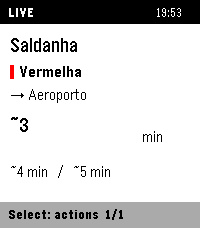

<!-- Generated by scripts/update_app_directory.py: do not edit by hand -->
[← All Pebble Developers](../developers.md)

# Rafael Borges

*1 app · Last updated 2026-11-23 · [About these lists](../about-app-lists.md)*

Links: [Pebble App Store](https://apps.repebble.com/apps/dev/rafael-borges_f664d570de6a70fabb4a2cab) · [GitHub (rafaelborges29)](https://github.com/rafaelborges29)

<h2 class="app-name" id="app-dce54d3eb02943f1935e1529"><a href="https://apps.repebble.com/dce54d3eb02943f1935e1529">Metro Lisboa</a> v0.4.0</h2>
<a class="app-source" href="https://github.com/rafaelborges29/pebble-metro" title="Source code" data-search-exclude>View source</a>

App · <a href="https://forum.rebble.io/t/1492" title="Discuss this app on the Rebble forum" data-search-exclude>Forum thread</a>

0BSD Released 2026-11-04 Updated 2026-11-09

Runs on: Round 2, Time 2

Lisbon Metro arrival estimates for Pebble Time 2 and Pebble Round 2. Save up to 16 favourites, see the next three predictions, and reopen with saved estimates for two recent routes. Live updates…

