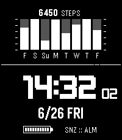
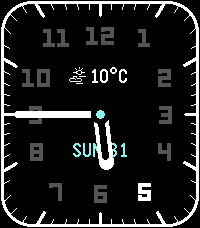
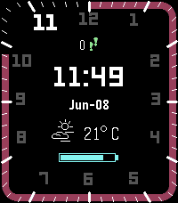

<!-- Generated by scripts/update_app_directory.py: do not edit by hand -->
[← All Pebble Developers](../developers.md)

# Rafael Pereira

*3 watchfaces · Last updated 2026-10-11 · [About these lists](../about-app-lists.md)*

Links: [Pebble App Store](https://apps.repebble.com/apps/dev/rafael-pereira_dd633264db7cf077fb225583) · [GitHub (rafaelc007)](https://github.com/rafaelc007)

<button type="button" data-filter="all" aria-pressed="true">All 3</button><button type="button" data-filter="watchface" aria-pressed="false">Watchfaces 3</button><button type="button" data-filter="watchapp" aria-pressed="false" disabled>Apps 0</button>

<label class="dev-sort">Sort by <select><option value="updated">Recently updated</option><option value="released">Newest release</option><option value="title">A–Z</option></select></label>

<h2 class="app-name" id="app-246fae41675540e09e468d19"><a href="https://apps.repebble.com/246fae41675540e09e468d19">Shocker-GPR</a> v1.1.1</h2>
<a class="app-source" href="https://github.com/rafaelc007/shocker-gpr" title="Source code" data-search-exclude>View source</a>

Watchface

Released 2026-06-25 Updated 2026-06-29

Runs on: Time 2

Watch face based on the more recent G-Shock GPR watches. - Displays time with optional seconds. - Displays a histogram of recent step activity.

<h2 class="app-name" id="app-2ecc5b56c55b46dc89a38a03"><a href="https://apps.repebble.com/2ecc5b56c55b46dc89a38a03">Analog Pretty</a> v1.2.7</h2>
<a class="app-source" href="https://github.com/rafaelc007/pebble-analog-pretty" title="Source code" data-search-exclude>View source</a>

Watchface

Released 2026-04-03 Updated 2026-06-17

Runs on: Round 2, Time 2, Pebble 2 Duo, Pebble 2, Time Round, Time, Classic

Simple analog watchface with weather support. Digits dynamically change every hour.

<h2 class="app-name" id="app-4e657ee63bad434faffca284"><a href="https://apps.repebble.com/4e657ee63bad434faffca284">Hybrid Minimal</a> v1.1.5</h2>
<a class="app-source" href="https://github.com/rafaelc007/hybrid-minimal" title="Source code" data-search-exclude>View source</a>

Watchface

Released 2026-04-12 Updated 2026-06-09

Runs on: Round 2, Time 2, Pebble 2 Duo, Pebble 2, Time Round, Time, Classic

Minimalistic Hybrid watchface. Numbers change color to change the currenet hour and progress bar shows current minutes.

