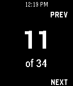

<!-- Generated by scripts/update_app_directory.py: do not edit by hand -->
[← All Pebble Developers](../developers.md)

# Rafi Jacoby

*1 app · Last updated 2026-10-11 · [About these lists](../about-app-lists.md)*

Links: [Pebble App Store](https://apps.repebble.com/apps/dev/rafi-jacoby_52f07e62a0cb6abe6d001d4d) · [GitHub (rjacoby)](https://github.com/rjacoby)

<h2 class="app-name" id="app-53cec3433967e94f5500000b"><a href="https://apps.repebble.com/53cec3433967e94f5500000b">PebblePoint</a> v1.0</h2>
<a class="app-source" href="https://github.com/rjacoby/pebblepoint" title="Source code" data-search-exclude>View source</a>

App

Released 2014-07-22 Updated 2014-07-22

Runs on: Time 2, Pebble 2 Duo, Pebble 2, Time, Classic

Control Microsoft PowerPoint on Mac OS X from your Pebble! Use the buttons to go to next/previous slides, or press and hold for last/first. Requires: - Mac OS X - Microsoft PowerPoint Download and…

