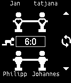

<!-- Generated by scripts/update_app_directory.py: do not edit by hand -->
[← All Pebble Developers](../developers.md)

# Railslove

*1 app · Last updated 2026-10-11 · [About these lists](../about-app-lists.md)*

Links: [Pebble App Store](https://apps.repebble.com/apps/dev/railslove_540dc11bd7b80f789a00013d) · [GitHub (stephanpavlovic)](https://github.com/stephanpavlovic) · [Website (kicker.cool)](http://kicker.cool)

<h2 class="app-name" id="app-540dc1d840aa75a29700018b"><a href="https://apps.repebble.com/540dc1d840aa75a29700018b">Kicker App</a> v1.4</h2>
<a class="app-source" href="https://github.com/stephanpavlovic/pebble-kicker-app" title="Source code" data-search-exclude>View source</a>

App

Released 2014-09-08 Updated 2015-06-20

Runs on: Time 2, Pebble 2 Duo, Pebble 2, Time, Classic

All your foosball matches on your wrist. Create your own league at http://kicker.cool

