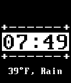

<!-- Generated by scripts/update_app_directory.py: do not edit by hand -->
[← All Pebble Developers](../developers.md)

# raindrop

*1 watchface · Last updated 2026-10-12 · [About these lists](../about-app-lists.md)*

Links: [Pebble App Store](https://apps.repebble.com/apps/dev/raindrop_53f38fd01b9f925a1800000f) · [GitHub (dallinac)](https://github.com/dallinac)

<h2 class="app-name" id="app-554eb7485feb9d37f30000ab"><a href="https://apps.repebble.com/554eb7485feb9d37f30000ab">DOS Watchface</a> v1.0</h2>
<a class="app-source" href="http://github.com/dallinac/pebbletutorial" title="Source code" data-search-exclude>View source</a>

Watchface

No licence Released 2015-05-10 Updated 2015-05-10

Runs on: Time 2, Pebble 2 Duo, Pebble 2, Time, Classic

A simple DOS watchface (Made from the Pebble C SDK tutorial). More coming soon!

