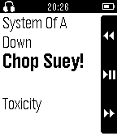

<!-- Generated by scripts/update_app_directory.py: do not edit by hand -->
[← All Pebble Developers](../developers.md)

# Ran Sagy

*1 app · Last updated 2026-10-11 · [About these lists](../about-app-lists.md)*

Links: [Pebble App Store](https://apps.repebble.com/apps/dev/ran-sagy_542be31b700caae0470000e0) · [GitHub (ransagy)](https://github.com/ransagy)

<h2 class="app-name" id="app-5554f75b078ad3f468000022"><a href="https://apps.repebble.com/5554f75b078ad3f468000022">Musica (DEPRECATED)</a> v1.32</h2>
<a class="app-source" href="https://github.com/ransagy/MusicaForPebbleWatch" title="Source code" data-search-exclude>View source</a>

App

Released 2015-05-14 Updated 2015-11-12

Runs on: Time 2, Pebble 2 Duo, Pebble 2, Time, Classic

** THIS APP IS NOW DEPRECATED AND NO LONGER MAINTAINED. Please see https://elbbep.cpfx.ca/ for the recommended solution for RTL on Pebble. ** Musica allows you to control your favorite Android…

