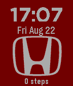
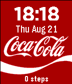
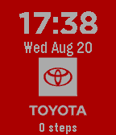
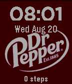

<!-- Generated by scripts/update_app_directory.py: do not edit by hand -->
[← All Pebble Developers](../developers.md)

# random360-pebble

*4 watchfaces · Last updated 2026-10-11 · [About these lists](../about-app-lists.md)*

Links: [Rebble App Store](https://apps.rebble.io/en_US/developer/682a9387fcffa4000710b5e2/1) · [GitHub (random360-pebble)](https://github.com/random360-pebble)

<button type="button" data-filter="all" aria-pressed="true">All 4</button><button type="button" data-filter="watchface" aria-pressed="false">Watchfaces 4</button><button type="button" data-filter="watchapp" aria-pressed="false" disabled>Apps 0</button>

<label class="dev-sort">Sort by <select><option value="updated">Recently updated</option><option value="released">Newest release</option><option value="title">A–Z</option></select></label>

<h2 class="app-name" id="app-68a8eb5e2dfa4d0009a22820"><a href="https://apps.rebble.io/en_US/application/68a8eb5e2dfa4d0009a22820">Honda</a> v1.0</h2>
<a class="app-source" href="https://github.com/random360-pebble/Honda" title="Source code" data-search-exclude>View source</a>

Watchface

Released 2025-08-22 Updated 2025-08-22 Rebble App Store

Runs on: Time 2, Time

A simple Honda watchface

<h2 class="app-name" id="app-68a7aa36a70ac100089822c5"><a href="https://apps.rebble.io/en_US/application/68a7aa36a70ac100089822c5">Coke</a> v1.0</h2>
<a class="app-source" href="https://github.com/random360-pebble/Coca-Cola" title="Source code" data-search-exclude>View source</a>

Watchface

Released 2025-08-21 Updated 2025-08-21 Rebble App Store

Runs on: Time 2, Time

A simple Coca-Cola watch face

<h2 class="app-name" id="app-68a64f315cc7670008314346"><a href="https://apps.rebble.io/en_US/application/68a64f315cc7670008314346">Toyota</a> v1.0</h2>
<a class="app-source" href="https://github.com/random360-pebble/Toyota" title="Source code" data-search-exclude>View source</a>

Watchface

Released 2025-08-20 Updated 2025-08-20 Rebble App Store

Runs on: Time 2, Time

A simple watchface with Toyota logo

<h2 class="app-name" id="app-68a5c7745cc7670008314341"><a href="https://apps.rebble.io/en_US/application/68a5c7745cc7670008314341">Dr.Pebble</a> v1.0</h2>
<a class="app-source" href="https://github.com/random360-pebble/Dr.Pebble" title="Source code" data-search-exclude>View source</a>

Watchface

Released 2025-08-20 Updated 2025-08-20 Rebble App Store

Runs on: Time 2, Time

A simple watchface with the Dr.pepper logo

