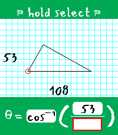
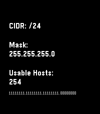
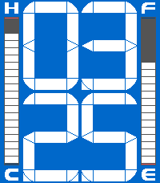
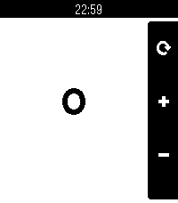
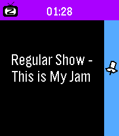
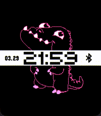

<!-- Generated by scripts/update_app_directory.py: do not edit by hand -->
[← All Pebble Developers](../developers.md)

# RandyTheSilly

*2 watchfaces and 4 apps · Last updated 2026-10-12 · [About these lists](../about-app-lists.md)*

Links: [Pebble App Store](https://apps.repebble.com/apps/dev/randythesilly_68e97cfa1c6711000953d795) · [Website (git.wetfence.xyz)](https://git.wetfence.xyz/RandyTheSilly)

<button type="button" data-filter="all" aria-pressed="true">All 6</button><button type="button" data-filter="watchface" aria-pressed="false">Watchfaces 2</button><button type="button" data-filter="watchapp" aria-pressed="false">Apps 4</button>

<label class="dev-sort">Sort by <select><option value="updated">Recently updated</option><option value="released">Newest release</option><option value="title">A–Z</option></select></label>

<h2 class="app-name" id="app-ed22b4471337441096cdb89e"><a href="https://apps.repebble.com/ed22b4471337441096cdb89e">Trigalarm</a> v1.0.0</h2>
<a class="app-source" href="https://git.wetfence.xyz/RandyTheSilly/Trigalarm" title="Source code" data-search-exclude>View source</a>

App · <a href="https://forum.rebble.io/t/1299" title="Discuss this app on the Rebble forum" data-search-exclude>Forum thread</a>

Released 2026-08-30 Updated 2026-08-30

Runs on: Round 2, Time 2

Trigalarm is a habit-correcting alarm for heavy sleepers that forces you to solve for theta in right triangles. It&#x27;s the perfect amount of thought to activate your brain in the morning! ## The…

<h2 class="app-name" id="app-3a5c54b7fe3e48d8ba6b234d"><a href="https://apps.repebble.com/3a5c54b7fe3e48d8ba6b234d">Subnet Helper</a> v1.2.0</h2>
<a class="app-source" href="https://git.wetfence.xyz/RandyTheSilly/Subnet-Helper" title="Source code" data-search-exclude>View source</a>

App · <a href="https://forum.rebble.io/t/874" title="Discuss this app on the Rebble forum" data-search-exclude>Forum thread</a>

Released 2026-04-12 Updated 2026-08-24

Runs on: Round 2, Time 2, Pebble 2 Duo, Pebble 2, Time Round, Time, Classic

Remember subnets on your wrist, not in your head. Main purpose is translating between CIDR notation and traditional masks. Also shows some other useful info, especially on Chalk, Emery, and Gabbro.

<h2 class="app-name" id="app-cd4b68957ad44e5ea3c3c6cd"><a href="https://apps.repebble.com/cd4b68957ad44e5ea3c3c6cd">Civic Segments</a> v1.0.1</h2>
<a class="app-source" href="https://git.wetfence.xyz/RandyTheSilly/Civic-Segments" title="Source code" data-search-exclude>View source</a>

Watchface · <a href="https://forum.rebble.io/t/1103" title="Discuss this app on the Rebble forum" data-search-exclude>Forum thread</a>

Released 2026-06-28 Updated 2026-07-05

Runs on: Time 2

A highly configurable clone of the beautiful 8th gen Honda Civic driver display assembly. The time font was carefully crafted to resemble the segmented display on the 8th gen Civic speedometer as…

<h2 class="app-name" id="app-6a2d9fdbe24af40009fa531e"><a href="https://apps.repebble.com/6a2d9fdbe24af40009fa531e">REcounter</a> v1.0.0</h2>
<a class="app-source" href="https://git.wetfence.xyz/RandyTheSilly/REcounter" title="Source code" data-search-exclude>View source</a>

App · <a href="https://forum.rebble.io/t/1054" title="Discuss this app on the Rebble forum" data-search-exclude>Forum thread</a>

Released 2026-06-13 Updated 2026-06-13

Runs on: Round 2, Time 2, Pebble 2 Duo, Pebble 2, Time Round, Time, Classic

Why? Because, in an era where a simple counter app would likely be left up to the AI overlords, I&#x27;d rather just fork something some guy made in 2014 and add touch support. This fork of the…

<h2 class="app-name" id="app-84498bc5f637462ead44802c"><a href="https://apps.repebble.com/84498bc5f637462ead44802c">1 More Episode</a> v1.0.0</h2>
<a class="app-source" href="https://git.wetfence.xyz/RandyTheSilly/1-More-Episode" title="Source code" data-search-exclude>View source</a>

App

Released 2026-05-10 Updated 2026-05-10

Runs on: Round 2, Time 2, Pebble 2 Duo, Pebble 2, Time Round, Time

&quot;#^%$! I fell asleep and woke up watching a different season! What was the last episode I saw?!&quot; - You, probably Well now your Pebble smartwatch can tell you! This app uses your Pebble Health data…

<h2 class="app-name" id="app-69c990b93406d0000832e53b"><a href="https://apps.repebble.com/69c990b93406d0000832e53b">Maan On My Wrist XL</a> v1.1</h2>
<a class="app-source" href="https://git.wetfence.xyz/RandyTheSilly/Maan-On-My-Wrist-XL" title="Source code" data-search-exclude>View source</a>

Watchface · <a href="https://forum.rebble.io/t/809" title="Discuss this app on the Rebble forum" data-search-exclude>Forum thread</a>

Released 2026-03-29 Updated 2026-04-05

Runs on: Round 2, Time 2, Time Round, Time

This is an unofficial and greatly expanded port of the &quot;Maan On My Wrist&quot; watchface to all color Pebbles, including the new Pebble Time 2/Round 2. Every half hour, one half of the creature will…

