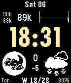

<!-- Generated by scripts/update_app_directory.py: do not edit by hand -->
[← All Pebble Developers](../developers.md)

# Réal Ouellet

*1 watchface · Last updated 2026-10-11 · [About these lists](../about-app-lists.md)*

Links: [Rebble App Store](https://apps.rebble.io/en_US/developer/52b9e65bc066cacd220000d5/1) · [GitHub (yodalf)](https://github.com/yodalf)

<h2 class="app-name" id="app-6934be788f67b20009024523"><a href="https://apps.rebble.io/en_US/application/6934be788f67b20009024523">CoinCan 2</a> v5.2</h2>
<a class="app-source" href="https://github.com/yodalf/coincan.git" title="Source code" data-search-exclude>View source</a>

Watchface · <a href="https://forum.rebble.io/t/108" title="Discuss this app on the Rebble forum" data-search-exclude>Forum thread</a>

Released 2025-12-06 Updated 2025-12-07 Rebble App Store

Runs on: Time 2, Pebble 2 Duo, Pebble 2, Time

10 years later... a new and improved CoinCan!

