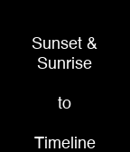

<!-- Generated by scripts/update_app_directory.py: do not edit by hand -->
[← All Pebble Developers](../developers.md)

# realjavajim

*1 watchface and 1 app · Last updated 2026-10-12 · [About these lists](../about-app-lists.md)*

Links: [Rebble App Store](https://apps.rebble.io/en_US/developer/6903d4d0856ddb000912d39e/1) · [GitHub (TensorChris)](https://github.com/TensorChris)

<button type="button" data-filter="all" aria-pressed="true">All 2</button><button type="button" data-filter="watchface" aria-pressed="false">Watchfaces 1</button><button type="button" data-filter="watchapp" aria-pressed="false">Apps 1</button>

<label class="dev-sort">Sort by <select><option value="updated">Recently updated</option><option value="released">Newest release</option><option value="title">A–Z</option></select></label>

<h2 class="app-name" id="app-69060c506d633e0008928e93"><a href="https://apps.rebble.io/en_US/application/69060c506d633e0008928e93">Sun2Timeline</a> v1.9</h2>
<a class="app-source" href="https://github.com/TensorChris/PebbleSun2Timeline" title="Source code" data-search-exclude>View source</a>

App

MIT Released 2025-11-01 Updated 2025-11-01 Rebble App Store

Runs on: Time 2, Pebble 2 Duo, Pebble 2, Time, Classic

CURRENTLY NOT FUNCTIONAL CANNOT REMOVE FROM REBBLE STORE UNFORTUNATELY THE IDEA WAS: It puts the Sunset &amp; Sundawn in the timeline.

<h2 class="app-name" id="app-6903d9978e00390009cf73d9"><a href="https://apps.rebble.io/en_US/application/6903d9978e00390009cf73d9">11 Weeks Calendar</a> v2.8</h2>
<a class="app-source" href="https://github.com/TensorChris/pebble-11weeks-config" title="Source code" data-search-exclude>View source</a>

Watchface

No licence Released 2025-10-30 Updated 2025-11-01 Rebble App Store

Runs on: Time 2, Pebble 2 Duo, Pebble 2, Time, Classic

11 weeks merged an 11 weeks calendar into a digital time watch face. Features: - 11-week calendar view showing past and future weeks - Digital time display with customizable components - Date…

