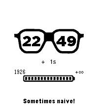

<!-- Generated by scripts/update_app_directory.py: do not edit by hand -->
[← All Pebble Developers](../developers.md)

# Reboot Yang

*1 watchface · Last updated 2026-10-11 · [About these lists](../about-app-lists.md)*

Links: [Rebble App Store](https://apps.rebble.io/en_US/developer/5a424b640dfc322b4500181f/1) · [GitHub (yulingtianxia)](https://github.com/yulingtianxia) · [Website (yulingtianxia.com)](http://yulingtianxia.com/blog/2018/01/15/How-to-make-a-Pebble-watchface/)

<h2 class="app-name" id="app-5a4b9bfc0dfc329496001b60"><a href="https://apps.rebble.io/en_US/application/5a4b9bfc0dfc329496001b60">MoHa : +1s For Haha</a> v1.2</h2>
<a class="app-source" href="https://github.com/yulingtianxia/Pebble-MoHa" title="Source code" data-search-exclude>View source</a>

Watchface

Released 2018-01-02 Updated 2018-01-06 Rebble App Store

Runs on: Round 2, Time 2, Pebble 2 Duo, Pebble 2, Time Round, Time, Classic

MoHa is a simple and young watchface for you! Keep every second! Excited!

