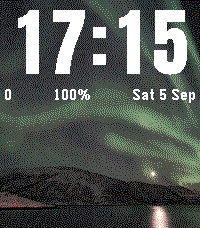

<!-- Generated by scripts/update_app_directory.py: do not edit by hand -->
[← All Pebble Developers](../developers.md)

# Rediro

*1 watchface · Last updated 2026-10-12 · [About these lists](../about-app-lists.md)*

Links: [Pebble App Store](https://apps.repebble.com/apps/dev/rediro_00bf067baa219415db5a7f43) · [GitHub (Rediro-MC)](https://github.com/Rediro-MC)

<h2 class="app-name" id="app-cdf80cc3bf6745b1a310e4c8"><a href="https://apps.repebble.com/cdf80cc3bf6745b1a310e4c8">Galleria</a> v1.0.0</h2>
<a class="app-source" href="https://github.com/Rediro-MC/galleria-da-polso" title="Source code" data-search-exclude>View source</a>

Watchface

MIT Released 2026-09-05 Updated 2026-09-19

Runs on: Time 2, Pebble 2 Duo

Your photos as the watchface. Designed for Pebble Time 2 (colour display); also runs on Pebble 2 Duo. Crop them on the phone: up to 12 rotate on the watch, or shake for the next one. Big bitmap…

