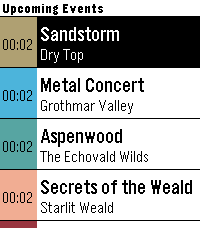
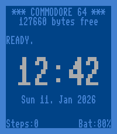

<!-- Generated by scripts/update_app_directory.py: do not edit by hand -->
[← All Pebble Developers](../developers.md)

# Reiner Herrmann

*1 watchface and 1 app · Last updated 2026-10-11 · [About these lists](../about-app-lists.md)*

Links: [Pebble App Store](https://apps.repebble.com/apps/dev/reiner-herrmann_6964158c7ae0390008ae0539) · [Codeberg (reinerh)](https://codeberg.org/reinerh)

<button type="button" data-filter="all" aria-pressed="true">All 2</button><button type="button" data-filter="watchface" aria-pressed="false">Watchfaces 1</button><button type="button" data-filter="watchapp" aria-pressed="false">Apps 1</button>

<label class="dev-sort">Sort by <select><option value="updated">Recently updated</option><option value="released">Newest release</option><option value="title">A–Z</option></select></label>

<h2 class="app-name" id="app-69e16008fb8025000832dd2b"><a href="https://apps.repebble.com/69e16008fb8025000832dd2b">GW2 Event Timers</a> v0.4.1</h2>
<a class="app-source" href="https://codeberg.org/reinerh/pebble-gw2et" title="Source code" data-search-exclude>View source</a>

App · <a href="https://forum.rebble.io/t/887" title="Discuss this app on the Rebble forum" data-search-exclude>Forum thread</a>

Released 2026-04-16 Updated 2026-09-20

Runs on: Round 2, Time 2, Pebble 2 Duo, Pebble 2, Time Round, Time

Pebble app that displays upcoming ingame events in Guild Wars 2.

<h2 class="app-name" id="app-696416659fee1e0009d5bc94"><a href="https://apps.repebble.com/696416659fee1e0009d5bc94">C=64</a> v0.1</h2>
<a class="app-source" href="https://codeberg.org/reinerh/pebble-c64" title="Source code" data-search-exclude>View source</a>

Watchface · <a href="https://forum.rebble.io/t/481" title="Discuss this app on the Rebble forum" data-search-exclude>Forum thread</a>

Released 2026-01-11 Updated 2026-01-11

Runs on: Time 2, Pebble 2 Duo, Pebble 2, Time, Classic

Watchface inspired by the start screen of a Commodore 64.

